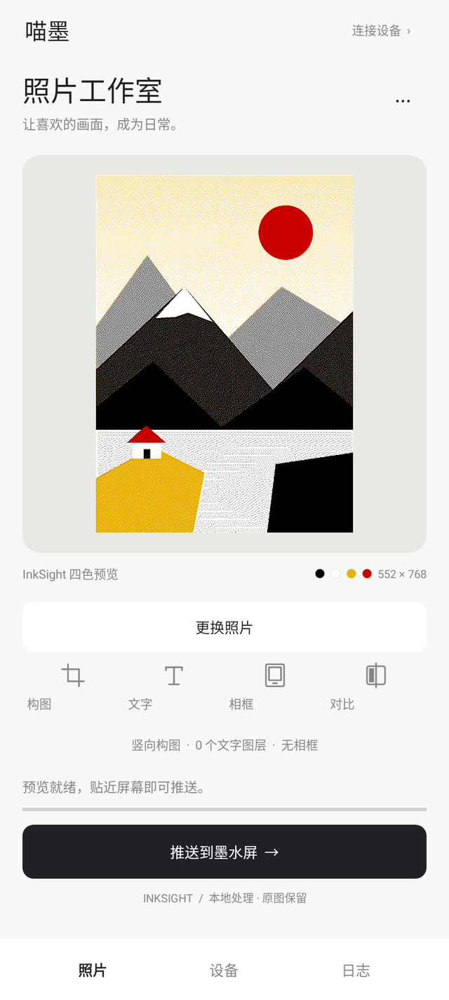
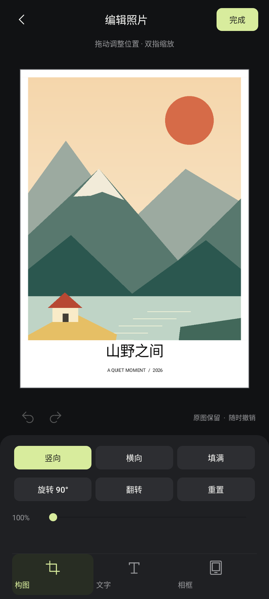
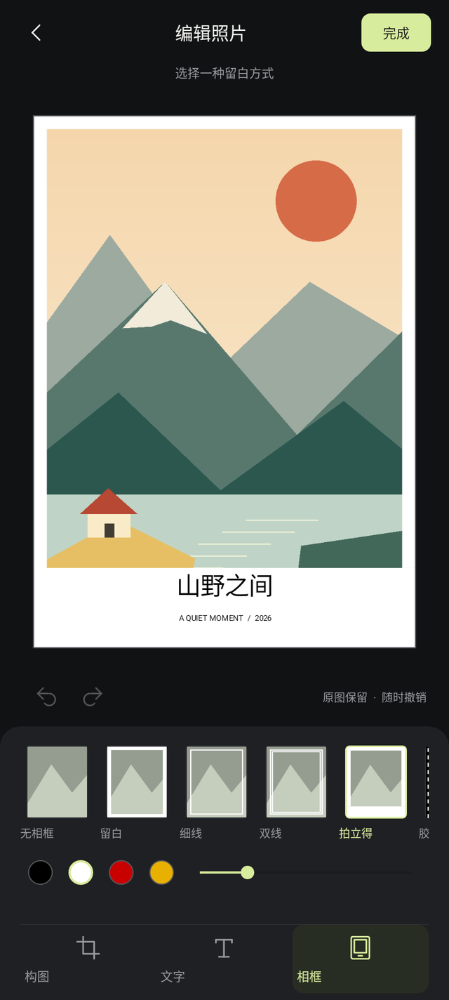

<p align="center"></p>

# 喵墨 · Miaomo

把喜欢的照片放进墨水屏。面向华为 3.98 英寸、552×768 四色 NFC 墨水屏的 Android 照片编辑与推图 App，使用手机内置 NFC；标准通道无需 Shizuku，专用寻卡通道使用 Shizuku，无需 root。

当前版本 **0.5.10-test**，Android 8.0+。新增「经典四色 / 自然暖调」照片滤镜及即时四色预览。ST54L 原生通道仍需小米 15 Pro 实测确认，接口存在不代表已能寻卡或刷新。

> **复杂照片 / 细密抖动的稳定刷图条件：对齐线圈，保持供电。**
> 先对齐手机与屏幕的 NFC 线圈并全程贴稳；手机 NFC 供能不足、出现 `68CA` 时，可使用经过核对的 **3.3V 辅助供电**改善稳定性。外接电源只补充供能，仍须保持 NFC 对齐通信，直到屏幕刷新完成。具体接法见 [3.3V 供电说明](docs/POWER_3V3.md)。

0.5.10 在「编辑照片 → 滤镜」中提供「经典四色 / 自然暖调」，保存每张照片的选择，支持真实四色预览、撤销/重做和取消。NFC 编码和兼容通道保持原有实现。详见 [滤镜说明](docs/EINKWARM.md)及 [设计与测试](DESIGN.md)。

## 功能

- 相册/文件选图，横屏和竖屏构图，旋转、镜像、拖动及双指缩放。
- 多行文字图层：字体、字号、颜色、底色、描边、角度、对齐、复制和排序。
- 留白、细线、双线、拍立得、胶片相框；撤销/重做与最近编辑状态恢复。
- 经典四色 / 自然暖调滤镜、原图/四色对比、保存预览与 NFC 推图。
- 自动 / 标准 NFC 两种连接方式；标准 ISO-DEP 通道跨品牌、无需 Shizuku，支持 D1 检测和经校验的照片上传。
- NXP Q-Poll / ST54L 实验专用寻卡、传输进度和本地日志导出；部分 ROM 可显式启用无 RF 读回兼容。
- “检查手机兼容性”生成本机接口报告，区分标准、NXP 与 ST54L 通道；无专用接口时自动尝试标准 NFC。
- NFC Binder 能力只读盘点，帮助确认 ROM 是否提供 RF 配置、vendor NCI 和 ReaderMode 接口。
- GitHub 发布版本检查、更新说明和 APK 下载入口；可选启动时每日检查。

照片处理在手机本地完成，无需 InkSight 服务器、API Key 或软路由。更新检查通过 HTTPS 读取 GitHub 的公开发布信息，不上传照片、日志或屏幕标识；自动检查默认关闭。

0.5.9 新增缺少接口、接口存在但控制器未适配的弹窗，以及「导出适配反馈」。反馈包含系统构建版本、实际芯片来源、接口签名、权限状态、当前阶段和完整错误，方便按证据补充适配；未连接 Shizuku 或检测失败时，不会直接判定手机不支持。详见 [适配反馈指南](docs/COMPATIBILITY_FEEDBACK.md)。

0.5.8 在旧 ST 桥接读帧返回 `15 0B` 时，先尝试文档化的原生读帧 `OID=1E`；仅有效快照落盘后才用 `OID=1D` 设置 7A，原始帧按同一通道逐字节恢复并读回。若读取仍被拒且后台确认没有配置变更，则可回退标准 NFC。ST 参考源码将 `0B` 定义为“不支持”；现有日志尚不能确定拒绝发生在手机中间件还是芯片端，标准 NFC 也不保证能替代 7A 唤醒。

0.5.7 开放标准 ISO-DEP 检测与推图，解除入口对小米服务和 Shizuku 的强制依赖。Android 12 接口夹具与 Android 14 框架模拟测试不等于新增机型实测通过，详见 [兼容范围](docs/COMPATIBILITY.md)。

0.5.6 优化 NFC 断连提示：照片页显示线圈对准、贴近和保持贴合的操作说明，完整异常保留在调试日志。

0.5.5 新增 **ST54L 独立实验适配**：设备页启用后，根据厂商实际 `getChipId()` 选择 ST54L 短帧配置与读回恢复，不再依赖缺失的 `getRfDiscoverConfigurations()`。同时支持四/五参数 ReaderMode。它不向 ST 控制器发送 NXP QTag 命令。小米 15 Pro 已确认接口可见，但专用寻卡尚未成功；首次请只检测屏幕并导出日志。

NXP 路径仍要求 `NXP_MW > 0`；只有缺少 RF 快照的 NXP ROM 才需要手动打开“无 RF 配置读回兼容”。ST54L 使用自己独立的原始短帧快照与恢复，不需要打开该 NXP 开关。

## 界面一览

| 照片与四色预览 | 构图与缩放 | 相框与文字图层 |
| :---: | :---: | :---: |
|  |  |  |

以上为 0.5.7 源码运行后生成的 Android 原生界面渲染，示例画面为合成插画；设备状态为演示，不是手机实拍或实屏刷新照片。更多界面和逐步操作见 **[完整使用指南](docs/USAGE.md)**。

## 安装与使用

1. 从本仓库 Releases 下载 APK，或自行构建。
2. 开启 NFC，在「设备」页选择“自动选择”或“标准 NFC”。需要专用寻卡时启动 [Shizuku](https://shizuku.rikka.app/zh-hans/)，再连接并授权；标准模式不需要 Shizuku。
3. 开启手机 NFC，将完整 NFC 墨水屏贴稳在线圈位置，先读取屏幕信息。
4. 在「照片」页选图、编辑，生成四色预览并推送。
5. 上传结束后仍保持贴合，直到 App 报告屏幕刷新完成。

详细说明：[Shizuku 与连接](docs/USAGE.md#连接屏幕)、[照片编辑](docs/USAGE.md#编辑照片)、[推图和日志](docs/USAGE.md#推图与判断完成)。

`68CA` 是屏幕返回的低电压状态。刷新期间持续需要供电，上传完成不代表刷新完成。已拆除 NFC 主控、改接 ESP32 的屏幕不适用本 App 的 NFC 路径。

这是调试签名版本。自行构建、CI 构建和下载版的签名可能不同，不能保证相互覆盖安装。导出日志包含图片、标签 UID 和 APDU 等数据；提交 issue 前请筛选，避免上传私人照片及完整设备日志。

## 检查更新

在「设备 → 应用更新」点 **检查更新**。发现新版时显示版本号、更新说明和下载入口；点「下载 APK」会打开 GitHub 下载链接，由浏览器下载、系统提示你确认安装。

默认手动检查，可开启「启动时检查更新（每天最多一次）」。测试版会同时接收测试版与正式版，正式版只检查正式发布。网络失败和 GitHub 请求限制会明确提示，可以稍后重试；正在进行 NFC 操作时先结束操作再查看更新。

更新依据本仓库 GitHub Releases 的版本号。检查只请求公开发布信息，无需 Token，也不上传照片、日志或设备标识。当前版本和更旧版本不会触发降级提示。详细操作见 [使用指南](docs/USAGE.md#检查更新)。

## 3.3V 辅助供电

部分手机能寻卡和上传，却在照片刷新阶段返回 `68CA`。开发期间外接 3.3V 后，观察到原始细密抖动照片完成 476 包上传，并取得 `019000 → 009000` 的忙到空闲确认，刷新命令发出后约 23.3 秒完成。

辅助供电仍由手机 NFC 发送图片，**保留原 NFC 主控**。对于已经核对电路和隔离关系的同版板，供电正极接原板 **3V3**，负极接 **GND**；不是把 ESP32 的 SPI 方案接到 App 上。

**[查看焊点图、接线方案、上电步骤与实测范围](docs/POWER_3V3.md)**。该成功记录未包含电压、电流和倒灌测量；不同板型须先核对，不能把示意图视为通用的双电源并联方案。

## 构建

需要 Python 3.9+、JDK 17+、Android SDK platform 35 和 build-tools 35.0.1。无需 Gradle 或 Android Studio。构建所需 Shizuku/AndroidX 开源工件在 `deps/`，指纹见 `dependency-lock.json`。

Windows PowerShell：

```powershell
$env:JAVA_HOME = 'C:\path\to\jdk-17'
$env:ANDROID_SDK_ROOT = 'C:\path\to\AndroidSdk'
python test_images.py
python build.py
```

Linux/macOS：

```bash
export JAVA_HOME=/path/to/jdk-17
export ANDROID_SDK_ROOT=/path/to/android-sdk
python3 test_images.py
python3 build.py
```

输出 `build/miaomo-0.5.10.apk`。首次构建在 `build/` 创建本地调试签名，私钥不入库。GitHub Actions 配置了协议、图像、照片滤镜、更新和 NFC 兼容性测试、构建和 APK 附件上传；运行结果以 Actions 页面为准。

如需沿用自己的已有调试签名，可通过环境变量 `MIAOMO_KEYSTORE` 指向本地 keystore；本构建脚本使用调试签名的标准口令，私钥不得提交。Android 更新界面、照片滤镜和 JSON 解析的回归需要 Gradle 8.7：先构建 APK，再运行 `gradle -p tests/android test`；首次运行会下载 Robolectric 及原生图形运行库，缓存设置见 DESIGN.md。

## 目录

| 路径 | 内容 |
| --- | --- |
| `src/dev/inknfclab/` | NFC 会话、协议、图片处理与 Android 原生界面 |
| `res/` | 主题、图标和 Android 资源 |
| `tests/` | 协议、模拟传输、图像与编辑状态测试 |
| `tests/inksight-fixtures/` | 合成输入和 InkSight 参考输出 |
| `assets/branding/` | 生成图标及来源记录 |
| `docs/` | 兼容性、验证范围与项目来源 |

包名沿用 `dev.inknfclab.test`。照片使用经典四色和自然暖调两条量化链路，其他历史算法留在源码中供研究。

## 来源与许可

本项目基于 [wiwiwei/ink-nfc-lab](https://github.com/wiwiwei/ink-nfc-lab) 的 Android 实现继续开发。

- NFC 协议、D1 解析和编码来自 [kur0neko/huawei-epd-pn532](https://gitee.com/kur0neko/huawei-epd-pn532)，继承 **PolyForm Noncommercial 1.0.0**。
- Q-Poll 接口参考 [ZhaoGY-N/huawei-nfc-eink-android-app](https://github.com/ZhaoGY-N/huawei-nfc-eink-android-app)。
- 图片增强、调色板和 Atkinson 参考 [datascale-ai/inksight](https://github.com/datascale-ai/inksight)（MIT）和 Pillow（HPND）。
- Shizuku（MIT）、AndroidX annotation（Apache 2.0）许可见 `THIRD-PARTY-LICENSES.txt`。
- 照片编辑交互参考 PhotoEditor、uCrop 和 Android-Image-Cropper，未引入其运行时依赖。

这是**非商业许可的源码公开项目**，不表示允许任意商用。请阅读 [LICENSE](LICENSE)、[NOTICE](NOTICE) 和 [第三方许可](THIRD-PARTY-LICENSES.txt)。

图标由 imagegen 使用 `gpt-image-2` 生成；原始提示词中的旧名仅用于保留生成记录。来源和验证范围详见 [docs](docs/PROVENANCE.md)。
