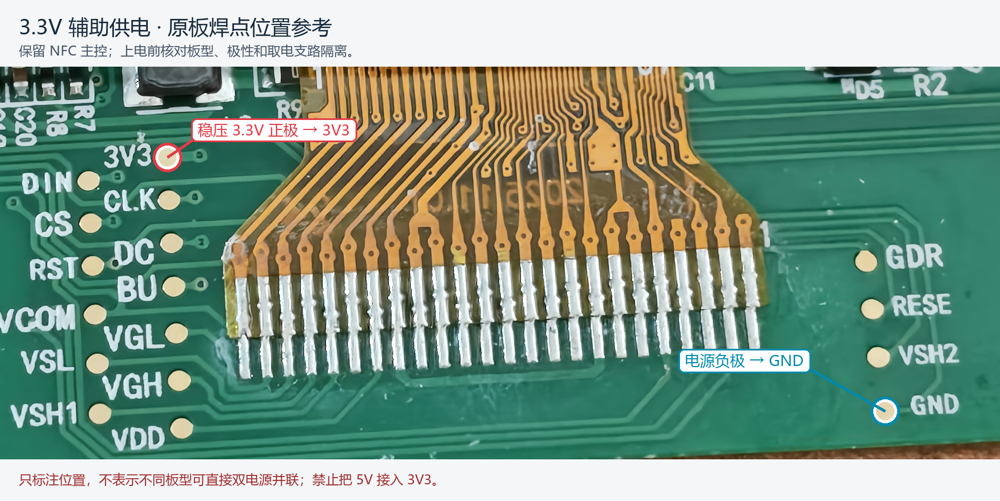
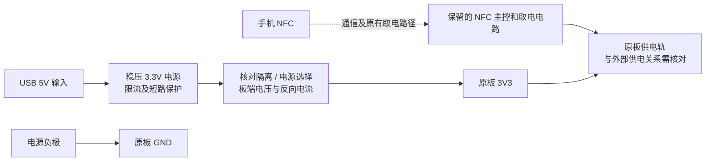

# 3.3V 辅助供电：手机 NFC 负责通信，外部电源补充供能

[返回首页](../README.md) · [使用指南](USAGE.md)

> **刷复杂照片：先对齐手机和屏幕的 NFC 线圈，全程贴稳；NFC 供能不足时，再用经核对的 3.3V 辅助供电改善稳定性。** 两种措施都围绕持续供能与通信；外接电源后仍需要保持线圈对齐，不能保证仅接电就适配所有手机和板型。

## 解决什么问题

屏幕能被发现、能读 D1、甚至能上传所有照片包，但在 D4/DE 刷新阶段返回 `68CA`，说明屏幕报告了低电压。NFC 场需要同时承担通信与取电，能读卡不代表刷新时功率足够。

开发期间，用户报告接入外部 3.3V 后，同一类细密抖动照片获得了完整完成记录：

| 检查项 | 已观察结果 |
| --- | --- |
| 图像 | 552×768、原始 1×1 抖动、100% 强度；当时 App 为 0.3.3-test |
| D3 上传 | 476/476 包均返回 `9000` |
| D4 接受 | `9000`，约 7.7 秒收到 |
| DE 刷新 | 先 `019000`（忙），后 `009000`（空闲） |
| 用时 | 从 D4 发出到空闲约 23.3 秒，31 次状态响应 |
| 本次低电压 | 未再出现 `68CA` |

这支持“辅助供电改善供能”的解释。记录没有包含电压波形、刷新峰值电流、两路供电倒灌或长期稳定性测量，也不是 0.5.2 的新增实屏回归。公开页面仅摘录协议结果，不包含用户照片或原始设备日志。

## 保留完整 NFC 主控

本方案只补充电源，**保留原 NFC 主控、线圈、屏幕排线和升压外围电路**。手机仍需通过 NFC 发现屏幕、发送图片并查询完成状态；接了 3.3V 也不能提前移走手机。

本方案不需要 ESP32 发 SPI 命令，也不要照 ESP32 改屏教程拆掉 FMSC/NFC 主控。已经拆主控改 SPI 的屏幕不能再用喵墨的 NFC 路径推图。

## 焊点位置参考

图片由开发者提供的原板照片裁切标注，仅定位能看见丝印的 **3V3** 和 **GND** 圆焊盘。以你自己板子的丝印、电路和测量结果为准；不同修订版不能直接套用照片坐标。

| 外部电源端 | 经过核对后接到原板 | 说明 |
| --- | --- | --- |
| 稳压 3.3V 正极 | `3V3` | 低压供电轨，不是天线端或屏幕高压输出 |
| 电源负极/地 | `GND` | 与辅助电源共地；NFC 通信无需额外接线到手机 |

**不要把 USB 5V、ESP32 的 5V/VBUS、单节锂电池的原始输出直接接到 3V3。** 也不要把外部电源接到 RF1/RF2、天线两端、VGH、VGL、VCOM、VSH 或未知 `VDD` 焊盘。屏幕所需高压仍由原板电路产生。

## 电源与隔离关系

优先用可测量、具有限流/短路保护的稳压 3.3V 电源进行验证。模块额定电流还要覆盖刷新峰值；现有记录没有测到这个峰值，因此这里不给未经验证的最低电流数值。

图中的“隔离/电源选择”表示必须检查的电气关系，不是已经在该板上验证过的模块或改线位置。外部 3.3V 和 NFC 整流输出可能连在同一供电轨；不能仅因为焊盘标着 3V3，就认定直接并联两路电源不会倒灌。

在没有原理图或测量结果时，先确认取电支路与外源的隔离关系，再安排同时上电测试；必要时由熟悉该板的人设计电源 OR-ing/理想二极管方案。只在外源串二极管不一定阻止外源流入 NFC 取电支路，还会有压降，不能把它当作通用解决办法。

### 用 ESP32-C3 / S3 开发板作为电源来源

如果手头只有 ESP32 开发板，只能把**经过确认的板上稳压 3V3 输出**作为候选电源来源：其输出能力、稳定性、反向电流和屏幕板的隔离条件仍需核对。此时只涉及电源正极和 GND，不接 DIN/CLK/CS/DC/RST/BUSY，不依赖 ESP32 固件。不要用 GPIO 输出给屏幕供电。

不同 C3 SUPERMINI 克隆板的稳压器和布线不同，不能只凭“C3 能用”推断所有开发板都适合。没有条件测量时，使用规格清楚的稳压电源更容易判断问题。

## 建议的验证顺序

1. 断开外部电源并移开手机，拍下完整板型和焊盘丝印；核对原主控仍在、排线未松动、3V3/GND 极性无误。
2. 在断电状态检查焊盘间是否短路，确认电源路径和隔离方式。不要在带电状态测电阻/通断。
3. 在不接屏幕时先测电源输出；按已核对的接法焊两根短电源线，做好绝缘及固定，避免拉扯细排线。
4. 先以受控电源检查板端供电；出现异常电流、发热或电压不稳就断电检查。确认供电关系后再引入手机 NFC 场。
5. 先读 D1，然后测试 App 生成的简单测试图，再用原先失败的同一张照片复测，记录电源配置、D3/D4/DE 和错误码。
6. 直到 DE 报告空闲、App 提示完成并观察实屏之后，再移开手机和断电。断电后墨水屏通常保留最后画面，但不会继续接收新图。

增加“上电等待”不能代替稳定供电；增大电容是否有效也取决于供电轨、容量、充电时间和刷新负载，本页不把未实测的电容数值列为必装项。
