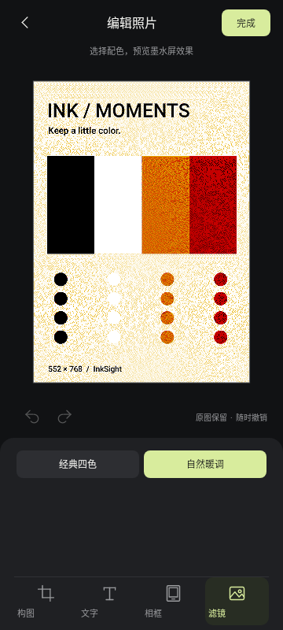

# 喵墨使用指南

[返回首页](../README.md) · [3.3V 辅助供电](POWER_3V3.md)

## 准备

需要 Android 8.0 以上手机、手机内置 NFC，以及保留原 NFC 主控和线圈的华为 3.98 英寸四色墨水屏。小米 15 Pro / Android 16 已确认 ST54L (`02.04.1188`)；旧 ST `0x15` 读帧返回 `0B`（参考 ST 源码为不支持）。0.5.8 新增原生读帧通道，但手机端尚未成功寻卡或刷新。

1. 打开本仓库 [Releases](https://github.com/3dhaoxinren/miaomo/releases)，下载安装 `miaomo-0.5.10.apk`。
2. 如需专用寻卡，按 [Shizuku 官方指南](https://shizuku.rikka.app/zh-hans/guide/setup/) 启动 Shizuku。支持无线调试的系统可按指南配对启动，也可使用电脑 ADB 启动；这里不需要 root。
3. 开启手机 NFC，打开喵墨。无需填写服务器地址或 API Key。照片处理在本地完成；检查更新时才读取 GitHub 公开发布信息。

0.5.8 更新了 Shizuku 后台服务；若提示服务版本较旧，请重启 Shizuku 后回到喵墨重新连接。小米 15 Pro 的首次验证请先用「检测屏幕」并导出日志，确认 D1 后再推图。

手机重启后通常需要重新启动 Shizuku；仅安装 Shizuku 管理器并不代表其服务已运行。

## 连接屏幕

1. 切到「设备」页，选择连接方式。**标准 NFC** 无需 Shizuku；**自动选择** 在 Shizuku 已连接时先只读检查专用接口，否则直接使用标准 NFC。需要专用寻卡时点 **连接 NFC 服务** 并允许 Shizuku 授权。
2. 把屏幕 NFC 线圈贴近手机 NFC 位置，保持稳定，点 **检测屏幕**。
3. 先确认 D1 信息读取成功、分辨率和色数检查通过，再刷图片。检测屏幕读取信息，不上传照片。
4. 「刷新上电等待」可选 1、2、3、5 秒，当前默认 5 秒。它是刷新命令中的供电等待参数，不是增加手机 NFC 功率的开关。

找不到卡时，先检查 Shizuku 是否运行并授权、NFC 开关、App 是否在前台，以及线圈位置。去掉手机壳和磁吸配件后重新贴合。检测过程中保持屏幕和手机不动；普通 NFC 寻卡失败，不能单凭此认定屏幕损坏。

「高级诊断」中的 **Q-Poll 寻卡**、**普通 NFC 寻卡对照**、**读取厂商诊断信息** 用于排查兼容性。无需把所有诊断操作都执行一遍才能使用。

### 多品牌与 Android 12（0.5.7）

设备页新增 **检查手机兼容性**，结果写入导出日志的 `compatibility.json`，包括 App/系统版本、NFC 状态、可尝试通道、控制器来源及缺失接口。它只检查接口，不寻卡、不发送 APDU；`vendor_ready=true` 只表示满足软件入口条件。

- **标准 NFC（跨品牌，无需 Shizuku）**：通过 Android 公共 ReaderMode 寻找 NFC-A/B ISO-DEP 标签，支持检测 D1 与推图。先经 D1 核对目标型号、色数和 UID，才开始写图。能否发现这块屏幕仍由手机 NFC 栈决定。
- **自动选择**：已连接 Shizuku 时先检查 NXP / ST54L 能力；缺少专用接口、芯片未知或未启用对应试验时，记录原因后尝试标准通道。ST54L 的 `0x15` 读帧查询若得到非零状态，仅在清理状态确认没有修改配置时回退标准 NFC；状态不确定或显式 Q-Poll 诊断会停止并保留错误。
- **标准模式未发现屏幕**：华为屏可能需要专有的 7A 轮询短帧。标准 API 无法补上此功能，不能靠延长等待或打开 Shizuku 获得 ROM 没有提供的接口。

小米 10 青春版 Android 12 的旧日志只证明缺少 RF getter，尚未确定其它厂商能力。请更新至 0.5.8，先试标准模式和只读兼容性检查，保存报告继续排查。不要根据“小米”“NXP”或“Android 12”直接认定支持 Q-Poll。

### 小米 15 Pro / ST54L 实验适配（0.5.8）

1. 在设备页检查兼容性，确认 `getChipId` 实际返回 `ST54L` 后，才启用 **ST54L 适配试验**；默认关闭。
2. 若 ST `0x15` 查询收到非零状态，0.5.8 只会在后台确认配置未被修改且会话已清理后，记录 `st-fallback-cleanup.json` 并尝试标准 NFC。标准 NFC 仍需要系统先激活屏幕为 ISO-DEP。
3. 若清理状态不确定，App 会停止，不回退；显式 Q-Poll 诊断也不会自动切换。`st_vendor_read_rejected_status` 会记录原始 ST 状态码。标准回退不代表已经寻到屏幕，只有 D1 正确后才会继续传图。

ST 配置日志可见 `controller_profile=st54l_custom_frames`、`st_vendor_tx/rx`、`st_frames_verified`；正常结束应出现 `restore=st_frames_matched`。若恢复失败会保留 `/data/local/tmp/miaomo-st54l-frames.json` 并阻止新会话；不要手动删除恢复快照，应导出日志排查。

此路径移植上游 ST54L 自定义轮询帧的读取/设置事务，保留快照与回读，**不含 root 注入、MIFARE 重选补丁、APC 增益调节或系统文件修改**。shell 权限可能不允许 vendor callback/命令，ROM 可能没有对应 API，也可能在 ISO-DEP 派发前发生 MIFARE 重选。出现异常时导出本次日志继续适配。本包在开发机完成模拟事务、UI 与构建测试，尚未在小米 15 Pro 证明实际刷屏。

### NXP ROM 缺少 RF getter 时

只有 NFC 厂商 profile 正向报告 `NXP_MW > 0` 时才选择原有 NXP QTag 路径。缺少 `getRfDiscoverConfigurations()` 的 NXP ROM，需在确认没有其他 NFC 操作后手动打开“允许无 RF 配置读回兼容”。该开关默认关闭，结束时无法读取 RF 配置证明恢复，因此日志标记 `restore=not_verifiable`。它不会被用来把 NXP 命令发给 ST54L。

## 选择照片

在「照片」页选择照片，按系统提示从相册或文件中打开图片。已有图片时按钮显示「更换照片」。选图后可进入编辑器；点击「完成」生成或更新四色预览。首页的「构图」「文字」「相框」可直接打开相应编辑区域。

原图只读取，编辑结果保存在 App 的工作副本中。最近照片和编辑状态可在重启 App 后恢复。

## 编辑照片

### 构图、旋转和缩放

- 选择竖向或横向构图。竖向画布为 552×768，横向为 768×552；横向图片在写屏时转换为屏幕要求的固定数据方向。
- 单指拖动调整主体位置，双指缩放；也可用缩放控件调整 100–400% 的范围。
- 按需旋转 90°、镜像，选择填满画框或完整显示。填满可能裁掉边缘，完整显示可能留白。
- 使用撤销/重做比较修改；点「重置」并确认「恢复」，会清除构图、文字与相框，滤镜恢复为自然暖调，可再撤销。

### 添加文字

 

切到「文字」，点 **＋ 添加文字**，输入多行文字，调整字号、字体、颜色、底色、加粗、描边、角度和对齐，点 **应用文字**。返回画布后可拖动文字，双指调整字号。图层可居中、复制、删除或置顶，最多 20 个文字图层。

应用文字后，再点击编辑器「完成」提交整张照片的编辑结果；仅关闭编辑器不会代替确认提交。选中图层的辅助边框不写入最终照片。

### 添加相框

切到「相框」，横向浏览无框、留白、细线、双线、拍立得和胶片样式，调整相框颜色与宽度。照片先完成四色处理，再叠加文字和相框；叠加颜色映射到最近屏幕色，减少文字边缘被抖动打散。可以结合文字制作标题、日期和照片卡片。

### 选择滤镜

在编辑器底部切到「滤镜」，选择 **经典四色** 或 **自然暖调**。自然暖调为默认值，切换后显示实际四色预览；选择随当前照片保存，支持撤销/重做，点「完成」提交，返回取消保留原状态。文字模式显示可交互的原图合成画布，完成后仍按所选滤镜生成四色结果。

已有四色图片会保留颜色编号，不会再次抖动；切换完整效果需要原始 RGB 照片。详细算法和测试范围见 [滤镜说明](EINKWARM.md)。

## 推图与判断完成

**复杂照片和细密抖动图需要稳定供能：先对齐 NFC 线圈并贴稳；若手机供能不足，可按 [3.3V 方案](POWER_3V3.md) 补充供电。即使外接 3.3V，也仍须对齐线圈完成 NFC 通信，不能把辅助供电当成移走手机的条件。**

1. 回到首页检查四色预览；「对比」用于切换原图查看，右上角「…」中的「保存四色预览」可导出 PNG。
2. 保持 NFC 贴合和供电，点 **推送到墨水屏**。
3. App 先读取 D1 并检查设备，再认证、上传 D3 图像包、发送 D4 刷新和 DE 状态查询。
4. **476/476 包上传完毕后仍继续贴合。** 等 App 报告「屏幕刷新完成」，并检查实屏画面，再移开手机或关闭辅助电源。
5. 刷新可能持续二十多秒，实际时间随屏幕固件和供电而变；不要以固定秒数代替完成状态。

`019000` 表示屏幕仍忙，`009000` 表示设备报告空闲。单独收到 D4 的 `9000` 只说明命令被接受，不能当成画面刷新结束。设备报告空闲后也应观察实屏是否完整。

需要中止时点 **停止并保存**。供电异常或失败后先解决原因，再手动重试；不要通过连续重复点击推送补救供电问题。

## 常见问题

| 现象 | 先检查什么 |
| --- | --- |
| Shizuku 服务未连接 | Shizuku 是否正在运行、喵墨是否获授权；手机重启后重新启动服务 |
| 检测不到屏幕 | NFC 开关、App 前台状态、线圈位置与贴合、机型是否支持 Q-Poll |
| 上传完成却一直等待 | 屏幕可能仍在刷新；保持供电和贴合，查看 DE 是否从忙转为空闲 |
| `68CA` 低电压 | 刷新阶段供电不足；先调整贴合，再按 [3.3V 文档](POWER_3V3.md) 核对辅助供电条件 |
| TagLostException 或连接中断 | 移动、间距、供电或兼容性均可能导致；保留日志，不把它一律归因于低电压 |
| 预览正常、实屏有残影或淡带 | 先保存预览并与实屏对比，排查供电和面板刷新；协议完成不等于画面质量已验证 |
| 已改接 ESP32 的屏幕无法 NFC 寻卡 | 本 App 需要完整 NFC 主控；SPI 固件是另一条使用路径 |

## 导出调试日志

到「日志」页点 **分享日志** 或 **保存日志**，也可从「历史会话」找对应记录。复现时可以添加标记，说明发生错误的时刻。

反馈时建议提供手机型号、系统版本、App 版本、屏幕板型/固件、是否外接供电、操作顺序、错误码和预览/实屏差异。日志 ZIP 可能包含私人照片、标签 UID、原始 APDU 和设备信息，筛选后再公开；完整会话不应直接粘贴进公共 issue。

## 检查更新

从 0.5.3 开始，在「设备」页的「应用更新」卡片可以：

1. 查看当前安装版本，点 **检查更新**读取 GitHub 发布信息。
2. 发现新版后阅读更新说明，点 **下载 APK** 打开本仓库的下载链接，再按浏览器与系统提示安装。
3. 若新版只有源码、未提供 APK，先通过「版本详情」查看发布页。
4. 可开启 **启动时检查更新（每天最多一次）**；默认关闭，随时可以关掉。

测试版安装会同时检查测试版和正式版；正式版安装只检查正式版。相同版本与更旧版本不会提示安装。网络不可用、GitHub 限流或响应异常会显示「检查失败」，不会把失败显示为「已经最新」。正在推图或采集 NFC 会话时，先停止会话再操作更新入口。

照片处理继续在手机本地进行。联网权限用于 HTTPS 更新检查；检查请求不包含照片、日志、UID 或设备指纹，也不需要 GitHub 账号/Token。下载和安装由浏览器、Android 系统及用户确认完成。

## 图片来源

本页截图来自 0.5.7 源码的 Android 原生界面渲染，使用合成山景插画。NFC、授权和日志状态为渲染环境中的演示状态；截图不是实机连接成功的证明。它们展示实际控件与布局，未用设计稿替代 App 界面。

## 适配提示与反馈（0.5.9）

自动模式检测到缺少专用接口、控制器未适配或芯片尚未识别时，会弹出说明，并保留标准 NFC 尝试。点击「导出适配反馈」分享日志 ZIP；设备页的「检查手机兼容性」也有同一入口。未连接 Shizuku 表示专用接口尚未检查，检测失败不等于系统没有接口。更新后如提示后台较旧，请重启 Shizuku 并重新连接。

反馈时附上屏幕型号、操作步骤与实际现象；日志字段及排查方法见 [适配反馈指南](COMPATIBILITY_FEEDBACK.md)。
